# powermaster: Host Power Control

| | |
|---|---|
| Status | Implemented |
| Code | `powermaster/daemon` (daemon, TUI), `powermaster/api` (generated client) |
| Spec | `specs/openapi/powermaster.yml` (OpenAPI 3.0.3) |
| Related | [`DESIGN-powerwarden.md`](DESIGN-powerwarden.md) (demand-driven power policy) |

## Overview

**powermaster** controls the power of a small fleet of bare-metal hosts. It owns the host inventory (read from
Vault or OpenBao), polls the hardware (PDU outlets, IPMI chassis state, ping, SSH), keeps one state machine per host,
and runs the power sequences. Callers ask for one of four actions on a host: **powerup**, **powerdown**,
**powercut** (cut the PDU outlets) and **reboot**. Powermaster enforces the inventory's `locked` flag, records every
command and its outcome in SQLite, and pushes every state and command change to subscribers over server-sent events.
A terminal UI (`powermaster monitor`) lets an operator watch hosts and send power actions.

Powermaster is mechanism, not policy. It has no notion of jobs, demand, idleness, exclusion or cooldown; deciding
when a host should be on is powerwarden's job ([`DESIGN-powerwarden.md`](DESIGN-powerwarden.md)). It is the only
process that holds BMC, PDU or SSH credentials.

## Goals and non-goals

### Goals

- One HTTP API is the only way to request power actions and to read host power state.
- Every request becomes a durable command row with a deadline and a terminal outcome (`succeeded` or `failed`, with
  an error).
- Host state has one writer at a time, and every state change commits in the same SQLite transaction as the command
  change that caused it.
- A failed powerup or reboot ends in an off state with `last_error` and `power_failed_at`. A host never sticks in a
  transitional state.
- `on` means IPMI, ping and SSH all succeeded inside the attempt. The chassis power bit alone is never `on`.
- `locked` is enforced on every action: 409 unless `force=true`.
- A subscriber learns of a state or command transition in **under 1s**.
- Every time and interval is configurable, per host class and per PDU class.
- The host JSON never contains IP addresses, BMC credentials, SSH keys, PDU addresses or tokens.

### Non-goals

- Deciding when a host should be on or off: no demand, worker liveness, idle dwell, exclude or boot cooldown.
- Any knowledge of jobs, schedulers or host capability tags (powerwarden owns tags).
- High availability. One daemon per fleet.
- Redfish or a second power-control plane.
- Prometheus metrics or a message bus.

## Key decisions

1. **Mechanism, not policy.** Powermaster executes a command if the host exists, is not locked (or `force=true`),
   and has no conflicting command in flight. It never starts an action on its own and never refuses a powerup
   because an earlier one failed.
2. **SQLite holds state and commands.** A request is one transaction: insert the command, set the transitional
   state, set a new attempt token. A sequence's terminal write is one transaction guarded by the attempt token.
   Restart recovery reads the tables. Poll results (`pdu`, `ipmi`, `ping`, `ssh`) are held in memory and exposed
   through the API and events.
3. **Hardware behind interfaces.** `IPMI`, `PDU` and `Net` (ping, SSH) interfaces (`hw/`) with real implementations
   and a fake lab (`hw.FakeLab`). Tests drive the fakes.
4. **Reboot is IPMI first, PDU if required.** Chassis off by IPMI. If IPMI cannot get the chassis off, cycle the
   host's PDU outlets. Then chassis on, ping, SSH. No SSH shutdown.
5. **Powerdown tries SSH shutdown first.** SSH shutdown, then IPMI off, then PDU off, under a real budget.
6. **Two off states.** `soft_off` (chassis off, outlets powered, BMC answering) and `cold_off` (every outlet cut).
   `powercut` moves a host to `cold_off`.
7. **Push changes over SSE.** `GET /v1/events` streams host and command transitions. `GET /v1/hosts` is the truth
   after a reconnect.
8. **Inventory in Vault, timings in config.** Vault holds hosts, credentials and `locked`. `config.yaml` holds
   timings and class membership. Neither is edited through the API.
9. **Generated client, hand-written server.** `oapi-codegen` generates `powermaster/api` from the spec;
   powerwarden and the TUI import it. Handlers are plain `net/http`.
10. **Named bearer tokens, fail closed.** One token per caller (powerwarden, each operator), so `requested_by` is
    real. No tokens configured means no start.

## Design

### Scale and timing

- Design capacity: **16 hosts**. Callers: powerwarden (a few requests per minute and one event subscription) and
  TUIs (one event subscription each). Under 10 requests/s.
- Event latency **under 1s** from the commit that caused it.
- Polling: every poller waits **2s between polls** (not a fixed cadence). See [Pollers](#pollers).
- Budgets are sums of configured stage times (defaults below). The recorded deadline is the budget plus
  `deadline_slack` (default **60s**), so the sequence's own terminal write lands before recovery would act.

| Action | Stages, in order (config key) | Default budget |
|---|---|---|
| `powerup` | PDU outlets on (`pdu_outlet_wait` per outlet), IPMI reachable (`ipmi_ping_wait`), chassis on (`chassis_on_wait`), ping and SSH (`ping_ssh_wait`) | 900s + 30s per outlet |
| `powerdown` | SSH shutdown (`ssh_shutdown_wait`), chassis off after SSH (`post_ssh_off_wait`), IPMI power-off (`ipmi_off_command_wait`), PDU outlets off (`pdu_outlet_wait` per outlet), final off (`final_off_wait`) | 730s + 30s per outlet |
| `powercut` | From `soft_off`: PDU outlets off only. Otherwise the `powerdown` stages, then PDU outlets off for any still on | powerdown budget + 30s per outlet |
| `reboot` | IPMI power-off (`ipmi_off_command_wait`), chassis off (`reboot_chassis_off_wait`), [only if still on: PDU outlets off, `reboot_pdu_settle`, PDU outlets on], chassis on (`chassis_on_wait`), ping and SSH (`ping_ssh_wait`) | 780s; + 30s settle + 60s per outlet when escalated |

### Components

```
 powerwarden ──HTTP(S) + /v1/events──┐
 powermaster monitor (TUI) ──────────┤
                                     ▼
                     ┌──────────────── powermaster ───────────────────────┐
                     │ HTTP API /v1 ── store (SQLite: hosts, commands)    │
                     │      │                     ▲                       │
                     │      ▼                     │ claim / finish        │
                     │ event hub ◀── sequences (per host, one at a time)  │
                     │      ▲                     │                       │
                     │ pollers (IPMI, ping, SSH, PDU) ── in-memory status │
                     │ inventory (Vault) + config.yaml (timings, classes) │
                     └────────────────────────────┬───────────────────────┘
                                                  ▼
                                           PDU, IPMI, SSH
```

| Path (under `powermaster/daemon`) | What |
|---|---|
| `config.go`, `config.yaml.example` | Config, classes, resolved budgets, TUI URL resolution |
| `manager.go`, `sequence.go`, `poller.go`, `recovery.go`, `view.go` | Per-host goroutines, sequences, pollers, recovery, host views |
| `inventory/` | Vault inventory (`locked`), a static source for tests |
| `hw/` | `IPMI`, `PDU`, `Net` interfaces, real implementations, `FakeLab` |
| `store/` | SQLite: `hosts`, `commands`, migrations |
| `internal/events` | Event hub (seq + ring) behind `/v1/events` |
| `internal/httpapi` | Handlers using the generated types; bearer tokens |
| `internal/tui` | `powermaster monitor` |
| `cmd/powermaster` | `serve`, `check`, `monitor`; Dockerfile |

### Host state machine

States: `soft_off` (chassis off, outlets still powered, the BMC answers), `cold_off` (chassis off and every outlet
cut), `powering_on`, `on`, `powering_off`, `rebooting`, and `unknown` (no observation yet). There is no plain `off`.
`hosts.state_since` records when the state last changed value; a terminal write into the state a host is already in
does not move it.

```mermaid
stateDiagram-v2
  [*] --> unknown: host appears in inventory
  unknown --> cold_off: full PDU observation, all outlets off
  unknown --> soft_off: outlets not all off, chassis off
  unknown --> on: outlets not all off, chassis on
  soft_off --> powering_on: powerup committed
  cold_off --> powering_on: powerup committed (outlets on first)
  powering_on --> on: IPMI and ping and SSH, attempt current
  powering_on --> soft_off: failure or deadline, any outlet on
  powering_on --> cold_off: failure or deadline, all outlets off
  on --> powering_off: powerdown or powercut committed
  soft_off --> powering_off: powercut committed
  powering_off --> soft_off: powerdown done; powercut failed after chassis off
  powering_off --> cold_off: powerdown fallback cut the outlets; powercut done
  powering_off --> on: fallbacks finished and chassis still on
  on --> rebooting: reboot committed
  soft_off --> rebooting: reboot committed
  cold_off --> rebooting: reboot committed
  rebooting --> on: chassis cycled, then IPMI and ping and SSH, attempt current
  rebooting --> soft_off: failure or deadline, any outlet on
  rebooting --> cold_off: failure or deadline, all outlets off
  powering_on --> unknown: restart recovery
  powering_off --> unknown: restart recovery
  rebooting --> unknown: restart recovery
```



**Writers of `hosts.state`.** Three, and no others. Pollers never write state.

- **Enqueue.** One transaction: insert the command (`queued`, deadline, new attempt), set `hosts.state` to the
  transitional state, set `hosts.attempt`.
- **Sequence terminal write.** One transaction:
  `UPDATE hosts SET state=?, last_error=?, power_failed_at=? WHERE hostname=? AND attempt=?` plus the command's
  terminal update. Zero rows matched means the attempt was superseded; the write is dropped and logged at warn.
- **Seed and recovery.** An `unknown` host is seeded only once its PDU poll has read every outlet. Then: all outlets
  off gives `cold_off` (whatever the BMC says: it has no power); otherwise the chassis bit gives `on` or `soft_off`;
  outlets on (or mixed) with a BMC that does not answer stay `unknown` until a command moves the host. The seed runs
  after every IPMI poll (success or failure) and every PDU poll, and writes only while the state is still `unknown`.
  A host with a dead BMC and cut outlets therefore seeds `cold_off` instead of sticking in `unknown`. No ping or SSH
  is required; requiring them would seed a chassis-on host as `soft_off` and invite another powerup.

**Recovery at start.** No sequence goroutine survives a restart.

- `running` `powerup` or `reboot`: command `failed` (`error: "interrupted"`), state `unknown`,
  `power_failed_at = now`, new attempt, even if the deadline is far off. The next polls re-seed the host; a blind
  off state could mark a chassis-on host off, or hide that the outlets are cut.
- `running` `powerdown` or `powercut`: command `failed` (`interrupted`); state `unknown`, no `power_failed_at`,
  re-seeded from the next polls.
- `queued` commands: left `queued`; the claim loop starts them.

A deadline check runs every `recovery_interval` (default 15s): a `running` command past its deadline is cancelled
through its context, and the goroutine's own terminal write reports the failure. Recovery never writes state for a
host whose goroutine is still running.

### Sequences

All stage loops run under one context whose deadline is the budget. A cancelled context is a failure.

`powerup(ctx, attempt)`:

- If the last IPMI poll says the chassis is on, skip PDU on and the chassis power-on command, so a live chassis is
  not power-cycled. Still require ping and SSH.
- Otherwise PDU outlets on (`pdu_outlet_wait` each), then chassis power-on, resent until it succeeds or
  `chassis_on_wait` ends.
- Then ping and SSH until both succeed or `ping_ssh_wait` ends.
- Success: state `on`, command `succeeded`. Failure: `last_error`, `power_failed_at`, command `failed`, and the off
  state that matches the outlets. The sequence reads the outlets at the end and falls back to the last PDU poll: all
  outlets off gives `cold_off`; anything else (or no outlets, or unreadable) gives `soft_off`. Chassis on with SSH
  down at the end is a failure.
- A powerup of a host already `on` stores a `succeeded` command and returns 200 without touching hardware.

`powerdown(ctx, attempt)`:

- SSH shutdown (`ssh_shutdown_wait`), wait for chassis off (`post_ssh_off_wait`), IPMI power-off
  (`ipmi_off_command_wait`), PDU outlets off (`pdu_outlet_wait` each), final chassis-off wait (`final_off_wait`).
  Each step runs only if the chassis is still on.
- Chassis off at any point: state `soft_off`, command `succeeded`; `cold_off` when the PDU fallback cut the outlets.
  Still on after every fallback: state `on`, command `failed`.
- A powerdown of a host already `soft_off` or `cold_off` stores `succeeded` and returns 200.

`powercut(ctx, attempt)`:

- From `soft_off`: switch the outlets off (`pdu_outlet_wait` each) and nothing else. Success: `cold_off`. Failure:
  back to `soft_off` with `last_error` (`pdu_off_failed`).
- From any other state: run the `powerdown` stages, then switch off any outlets still on. Success: `cold_off`.
  Failing before the chassis is off ends `on` (as powerdown does); failing after the chassis is off ends `soft_off`.
- A powercut of a host already `cold_off` stores `succeeded` and returns 200.

`reboot(ctx, attempt)`:

- State `rebooting`. IPMI power-off, resent until it succeeds or `ipmi_off_command_wait` ends. Wait up to
  `reboot_chassis_off_wait` for the chassis to read off.
- **PDU escalation.** If the chassis is still on, switch the host's PDU outlets off, wait `reboot_pdu_settle`,
  switch them on. The command records `escalated = 1` and logs at warn. With no outlets the reboot fails
  `chassis_did_not_power_off`.
- IPMI power-on and the chassis-on, ping and SSH stages as in powerup. After a PDU cycle the BMC itself may need
  time to answer; that time comes out of `chassis_on_wait`.
- Success: `on`, `succeeded`. Failure after the power-on step: the off state that matches the outlets
  (`soft_off` or `cold_off`), `power_failed_at`, `failed`.
- A reboot of a host in `soft_off` or `cold_off` runs only the power-on half, outlets first.

### Pollers

- Per host: IPMI every `ipmi_interval`, ping and SSH every `network_interval`, PDU outlet state every
  `pdu_interval`; all three default to **2s**. Each interval is the wait *between* polls: the loop runs a poll, then
  waits one interval, so polls never overlap or queue. Typical costs measured on real hardware: IPMI chassis status
  about 10ms, Kasa HS300 read about 14ms, Eaton ePDU G3 login 4–7s, ping under 1ms, SSH login 0.2–0.6s. Real
  cadence is therefore about 2s on IPMI, the network and a Kasa, and about 10s on an Eaton (an 8s read plus the 2s
  wait); an `unknown` host re-seeds within one PDU poll cycle.
- Results update the in-memory status and emit a `host` event on change. An IPMI poll that errors sets
  `status.ipmi` to null (the BMC does not answer) and emits an event if that changed it.
- The PDU poller keeps two aggregates per host from the same outlet readings: `status.pdu` (all outlets on) and an
  internal all-outlets-off flag used by the seed. A partially read host (some outlet not yet read) has neither.
- **PDU poll deadline.** The loop gives each poll a context timeout equal to the interval, so a PDU read gets a 2s
  deadline. That works only because neither PDU client takes the context (`hw/real.go` `OutletStates` calls
  `GetOutlets` without it) and `pollPDU` does not check the context after the read. Anyone who makes those clients
  honour the context must first give the PDU poll its own timeout.
  `TestSlowPDUReadLongerThanIntervalStillUpdatesStatus` pins this.
- Each host owns its command and result channels. No shared fan-in, no cross-host requeue. The PDU poller demuxes by
  hostname.
- A per-host mutex allows at most one sequence per host. The command table already refuses a second in-flight
  command; the mutex covers the claim handoff.
- Supported PDUs (`pdustyle` in the inventory): `eaton_ePDU_G3_Managed`, `eaton_ePDU_G3_Managed_proxied`,
  `kasa_hs300`.

### Commands and idempotency

While a command for the host is `queued` or `running`, a request for the same action returns that row (202); a
different action returns 409 `command_in_flight`. A request whose target state already holds (`on` for powerup,
`soft_off` or `cold_off` for powerdown, `cold_off` for powercut) stores a `succeeded` row and returns 200. Reboot has
no "already there" state. The enqueue signals the host's goroutine, which claims the command at once; there is no
polling delay. The `commands` table is under [Data model](#data-model).

### Event stream

`GET /v1/events` is server-sent events, one JSON object per event, each with a monotonically increasing `seq`:

- `host`: hostname, `state`, `state_since`, `status` booleans, `active_command` id. On every state write and every
  status change.
- `command`: the full command object. On enqueue, claim, escalation and terminal transition.
- `resync`: the client missed events and must re-read `GET /v1/hosts`.

A client reconnecting with `Last-Event-ID` gets every event still in the in-memory ring (`events.ring_size`, default
1,000), or a `resync` event. A comment heartbeat goes out every `events.heartbeat` (15s).

### TUI

`powermaster monitor` lists `GET /v1/hosts` and updates from `/v1/events`. Keys: `u` powerup, `d` powerdown (on a
`soft_off` host, powercut), `t` toggle (`powerup` from an off state, else `powerdown`), `r` reboot. On a locked
host, the `tui.locked_taps`-th (default fourth) `t` or `r` tap, each within `tui.locked_tap_gap` (3s) of the last,
sets `force=true` and waits `tui.locked_force_delay` (2s) before the `POST`. Pending commands blink until a terminal
`command` event; an escalated reboot shows `PDU`. Power only: no demand, worker or exclude data.

The API URL has no built-in default. It comes from, in order: `--api-url`, `tui.api_url` in `--config`,
`POWERMASTER_URL`, then the one-line file `~/.config/powermaster/url`. With none set, `monitor` exits with an error
naming every source. The token comes from `--token-file`, else `tui.token_file` (default
`~/.config/powermaster/token`).

## Configuration

`/etc/powermaster/config.yaml`, path overridable with `--config`.
[`powermaster/daemon/config.yaml.example`](../powermaster/daemon/config.yaml.example) holds every
key with its default. Unknown keys are a startup error. Durations use Go syntax (`30s`, `5m`).

| Key | Default | Meaning |
|---|---|---|
| `listen` | `:8092` | HTTP listen address (plain HTTP) |
| `state_path` | `/var/lib/powermaster/state.db` | SQLite file |
| `tokens_file` | `/etc/powermaster/tokens.yaml` | Bearer tokens, YAML `name: token`, must be mode 0600 |
| `log_level` | `info` | `debug`, `info`, `warn`, `error` |
| `vault.addr_env`, `vault.token_env`, `vault.skip_verify_env` | `VAULT_ADDR`, `VAULT_TOKEN`, `VAULT_SKIP_VERIFY` | Names of the environment variables holding Vault access |
| `vault.hosts_secret_path` | **none: required** for `serve` and `check` | KV v2 path of the inventory secret (mount `kv`) |
| `polling.ipmi_interval`, `network_interval`, `pdu_interval` | `2s` each | Wait between polls |
| `recovery_interval` | `15s` | Deadline check |
| `events.ring_size`, `events.heartbeat` | `1000`, `15s` | SSE resume ring and heartbeat |
| `timings.*` | see the table above | Stage times (defaults for every host and PDU) |
| `classes.<name>` | none | `hosts: [...]` or `pdus: [...]` plus a `timings` subset that overrides the defaults |
| `personal_keys.request_url` | none (off) | Optional. Absolute `http`/`https` URL (host required, no user information, no fragment) advertised by `GET /v1/key-request`; unset, that route is 404 |
| `personal_keys.url` | `""` (off) | Optional. The key-list URL: an absolute `http`/`https` URL (host required, no user information, no fragment). `""` turns the key list off: nothing pulls and nothing changes. A plain-`http` URL to a host that is not loopback is refused unless `allow_insecure_http` is true |
| `personal_keys.token_file` | `""` | Optional. The pull token, read by keyclient at start and before every pull |
| `personal_keys.cache_file` | none | **Required when `url` is set**; no default. Where the last good list is kept |
| `personal_keys.refresh` | `1m` | Time between pulls; must be greater than zero |
| `personal_keys.refresh_on_miss` | `5s` | Least time between pulls started by an unknown key; `0s` turns refresh on miss off; not negative |
| `personal_keys.allow_insecure_http` | `false` | Allows a plain-`http` `url` to a host that is not loopback. Applies only to `url`: `request_url` is advertised, never fetched |
| `tui.api_url` | `""` | TUI only; see [TUI](#tui) |
| `tui.token_file` | `~/.config/powermaster/token` | TUI only |
| `tui.locked_taps`, `locked_tap_gap`, `locked_force_delay` | `4`, `3s`, `2s` | TUI only |

**Resolution.** A host's stage time is `timings`, overridden by the host's class. `pdu_outlet_wait` for an outlet is
`timings`, overridden by the host's class, then by the PDU's class (the PDU is what is slow or fast). A host or PDU in
two classes, or a class naming a host or PDU not in inventory, is a startup error. Every inventory host must have at
least one PDU outlet, or the daemon refuses to start and the error names each offending host; `cold_off`, `powercut`
and the seed rule all depend on outlets. `GET /v1/hosts/{hostname}` returns the resolved budgets for that host.

**`powermaster check --config FILE`** (`just check`) loads the config and the Vault inventory, resolves the classes,
prints the host count and exits non-zero on any error. With `personal_keys.request_url` set it appends
` key_request=on` to the `ok:` line. With `personal_keys.url` set it also loads `tokens_file` with the loader `serve` uses,
builds the key-list source with the same helper and options as `serve` (never starting it, so it sends nothing and writes
no cache file), fails with the message below on a refusal, and appends ` key_list=on` after ` key_request=on`, then
` key_list_insecure_http=on` when `allow_insecure_http` is true and the URL is plain `http`. It never prints a token, a
hash or the pull token. Run it before deploying. `monitor` does not need the `vault`
section, so a TUI-only config may omit it.

The key-list settings are checked with the rest, and the first error is returned: a sub-key present in the file while
`url` is empty is an error (`personal_keys.<key> is set but personal_keys.url is empty`; presence counts, so
`refresh: 1m` alone is an error), and `cache_file` is required once `url` is set. Anything keyclient's `keylist.New`
refuses (a plain-`http` URL without `allow_insecure_http`, an unreadable `token_file`) stops the start and `check` with
`personal_keys: <keyclient's error>`; for the plain-`http` rule the message ends
`; set personal_keys.allow_insecure_http: true only for a network path you trust`. A URL is printed redacted (Go's `URL.Redacted()`; `"xxxxx"` when it does not parse).

Secrets are never in `config.yaml`. Tokens are in a separate mode-0600 file; Vault access comes from the
environment.

## API

The contract is `specs/openapi/powermaster.yml`. Bodies are `application/json`. Unknown JSON fields are rejected
with 400. All routes except `GET /v1/healthz` and `GET /v1/key-request` require `Authorization: Bearer <token>`. The examples use an
example host `node01.lab.example`.

Error body, every 4xx and 5xx:

```json
{ "error": "host_locked", "message": "host node01.lab.example is locked; retry with force=true" }
```

Codes: `unauthorized`, `bad_request`, `not_found`, `host_locked`, `command_in_flight`.

### `GET /v1/hosts` and `GET /v1/hosts/{hostname}`

```json
{
  "hostname": "node01.lab.example",
  "locked": false,
  "class": "node",
  "state": "powering_on",
  "state_since": "2026-10-07T19:00:00Z",
  "status": {"pdu": true, "ipmi": true, "ping": false, "ssh": false, "observed_at": "2026-10-07T19:00:05Z"},
  "last_error": "",
  "power_failed_at": null,
  "active_command": {"id": 17, "action": "powerup", "state": "running", "deadline": "2026-10-07T19:16:00Z"},
  "budgets": {"powerup": "930s", "powerdown": "760s", "powercut": "760s", "reboot": "780s"}
}
```

`state_since` is when `state` last changed value. The list omits `budgets`. `status` members are null before the
first poll. **The body must not contain `ip`, IPMI username or password, SSH keys, PDU addresses or tokens.** A
handler test asserts those substrings are absent from host JSON and events.

### `POST /v1/hosts/{hostname}/power`

```json
{ "action": "reboot", "reason": "manual: hung after kernel install" }
```

`action`: `powerup`, `powerdown`, `powercut`, `reboot`. `reason`: optional, at most 256 characters. `force` is a
query parameter (`?force=true`).

| Situation | Status |
|---|---|
| Command queued, or the same action already `queued`/`running` (returns that row) | **202** |
| Host already in the requested steady state; `succeeded` row stored | **200** |
| Unknown host | **404** |
| Locked and no `force=true` | **409** `host_locked` |
| A different action `queued` or `running` | **409** `command_in_flight` |

The body of 200 and 202 is the command object (the `commands` columns as JSON). `requested_by` is the name of the
token that made the request.

### Other routes

- `GET /v1/commands/{id}`; `GET /v1/commands?hostname=&state=&since=` (newest first, limit 200).
- `GET /v1/events` (SSE, above).
- `GET /v1/healthz`: no auth; 200 when serving with SQLite open, else 503. Does not check IPMI.
- `GET /v1/stats`: `hosts_by_state`, `commands_running`, `last_power_error`, `last_command_at`, subscriber count, and
  `personal_keys` when the key list is on (see Pulled key list).
- `GET /v1/key-request`: no auth; see Key request discovery below.

### Pulled key list

With `personal_keys.url` set, people's personal keys come from a key list pulled by keyclient's
`keylist.Source`. This doc restates only this daemon's settings (the table above); the contract is keyclient's
[`docs/CONTRACT.md`](https://github.com/resurgentech/keyclient/blob/main/docs/CONTRACT.md) and the behaviour
follows its [`docs/STATES.md`](https://github.com/resurgentech/keyclient/blob/main/docs/STATES.md). Neither is
copied here.

- **Bearer order.** (1) `tokens.yaml`, as before. (2) On a miss, with a non-empty token, the key list:
  `Source.LookupOrRefresh` (refresh on miss). A throttled or failed lookup is the usual `401` at once. Every token is
  `full` and every route may be called by `full`, so no route is closed to a pulled key.
- **Roles and names.** The only accepted role is `full` (`keylist.AcceptRoles`); an entry with another role is
  skipped. An entry whose name is the name of a `tokens.yaml` token, or whose SHA-256 is the hash of one, is skipped:
  the local token keeps its own name. A pulled key's name is the caller name, so it becomes `requested_by`.
- **Lifecycle.** `keylist.New` runs in `serve` right after the tokens load; an error stops the start. `Start(ctx)`
  runs with the serve context after the handler is built and before the listener starts, so a usable cache serves
  from the first request and the service starts even when the provider is down. After `Start` one info line is
  logged: `personal_keys: list origin=<origin> entries=<n> age=<age>`, with the age rounded to whole seconds. keyclient logs pull failures and recoveries
  itself; the daemon adds nothing.
- **Health.** `GET /v1/healthz` is unchanged: a provider that is down does not make the service unhealthy, it keeps
  serving the cached list. `GET /v1/stats` (authenticated) gains `personal_keys`, present only when `url` is set:
  `origin` (`none`, `cache` or `provider`), `entries`, `cache_failing`, and when known `age_seconds` and `list_time`
  (not when origin is `none`), `last_success`, `last_error` (non-printable characters replaced by `?`, at most 200
  characters). No hash, token or URL is included.
- **Tokens do not reload.** `tokens.yaml` is read once at start and there is no reload path, so the `Accept` check
  is stable for the life of the process (keyclient's K-16). If this daemon ever reloads its tokens while running, it must build a new `Source`.

### Key request discovery

The service advertises where its keys are requested. `GET /v1/key-request`, no authentication. `200` with
`{"request_url": "<absolute URL>"}` when the service is configured with `personal_keys.request_url`; `404` when it
is not. The tool must not rely on the body of a `404`. A tool may be given a request URL directly (a flag or an
environment variable); that value replaces discovery, and discovery is then not called. A tool with a request URL
from neither source behaves as it did before: a missing key is the same error as today. Discovery that fails any
other way (a network error, a status other than `200` and `404`, a `request_url` that is not an absolute `http` or
`https` URL) is an error the tool reports; it files nothing.

The setting is optional and off by default, and works with any provider that speaks this contract (fixtures:
`specs/fixtures/keyrequest/`). The route's row in the route table has auth `false`: no token is checked, and any
`Authorization` header is ignored.

### Client module

`powermaster/api` is generated from the spec with `oapi-codegen` v2 (types, client, embedded spec) by
`go generate`. The output is committed; `just drift` fails when it is stale, and a test checks that every spec
operation has a server route.

## Data model

`state_path` (default `/var/lib/powermaster/state.db`, on local disk). `modernc.org/sqlite` (no cgo), one `*sql.DB`,
`SetMaxOpenConns(1)`, WAL, `busy_timeout=5000`, a schema version table, migrations at open.

```sql
CREATE TABLE hosts (
  hostname        TEXT PRIMARY KEY,
  state           TEXT NOT NULL,      -- unknown | soft_off | cold_off | powering_on | on | powering_off | rebooting
  attempt         TEXT NOT NULL DEFAULT '',
  last_error      TEXT NOT NULL DEFAULT '',
  power_failed_at TEXT,
  updated_at      TEXT NOT NULL,
  state_since     TEXT NOT NULL       -- written only when state changes value
);

CREATE TABLE commands (
  id           INTEGER PRIMARY KEY,
  hostname     TEXT NOT NULL,
  action       TEXT NOT NULL CHECK (action IN ('powerup', 'powerdown', 'powercut', 'reboot')),
  state        TEXT NOT NULL CHECK (state IN ('queued', 'running', 'succeeded', 'failed')),
  force        INTEGER NOT NULL DEFAULT 0,
  escalated    INTEGER NOT NULL DEFAULT 0,   -- reboot fell back to a PDU cycle
  requested_by TEXT NOT NULL,                -- token name, e.g. "powerwarden", "alice"
  reason       TEXT NOT NULL DEFAULT '',     -- caller text, e.g. a demand id
  attempt      TEXT NOT NULL,
  created_at   TEXT NOT NULL,
  started_at   TEXT,
  deadline     TEXT NOT NULL,
  finished_at  TEXT,
  error        TEXT NOT NULL DEFAULT ''
);
```

Schema version 2 replaced a single `off` state with `unknown` (re-seeded from the polls), added `state_since`, and
widened the action check to admit `powercut`.

A host removed from inventory keeps its rows for history and is hidden from `GET /v1/hosts`. A host added to
inventory gets a row in state `unknown`.

### Inventory secret

The inventory is one KV v2 secret (mount `kv`, path `vault.hosts_secret_path`) with two keys, read once at start; a
restart picks up edits. Host capability tags are not inventory: powerwarden stores them.

```json
{
  "hosts": [
    {
      "hostname": "host01.example.com",
      "ip": "192.0.2.11",
      "user": "root",
      "sshkey": {"private": "<base64>", "public": "<base64>"},
      "ipmi": {"ip": "192.0.2.111", "port": 623, "username": "ADMIN", "password": "<secret>"},
      "pdu": [{"name": "pdu01", "outlet": 3}],
      "locked": false
    }
  ],
  "pdus": {
    "pdu01": {"ip": "192.0.2.50", "username": "admin", "password": "<secret>", "pdustyle": "kasa_hs300"}
  }
}
```

Every host needs a hostname, IPMI username and password, and at least one outlet on a known PDU. Every PDU needs
`ip`, `username`, `password` and `pdustyle`.

## Deployment

Powermaster is one container (or one binary) with one SQLite volume. Run it under any orchestrator: compose,
systemd, Nomad or Kubernetes all work, as long as there is exactly one instance per fleet.

### Image

`powermaster/daemon/cmd/powermaster/Dockerfile` builds a static binary on `golang:1.25-bookworm` and runs it
on `debian:bookworm-slim` with `ca-certificates`, `iputils-ping`, `openssh-client`, `sshpass` and `curl`. The image
copies `config.yaml.example` to `/etc/powermaster/`, declares the volume `/var/lib/powermaster`, exposes 8092 and
runs `powermaster serve --config /etc/powermaster/config.yaml`. The build context is the repository root.

Build it with the leaf justfile (`just image [tag]`, `just push [tag]` in `powermaster/daemon`). The recipes
read three settings from the environment, or from a gitignored `images.env` that `just` finds by searching upward
from the leaf (template: `images.env.example` at the repository root):

| Setting | Effect |
|---|---|
| `IMAGE_REGISTRY` | Registry prefix, e.g. `registry.example.com` (a trailing `/` is trimmed). Empty gives the local tag `powermaster:<tag>`; `push` then refuses to run |
| `IMAGE_CA_CERT` | Absolute path to an extra CA certificate (PEM) to trust inside the image, e.g. the CA of an internal Vault. The recipe stages it as `cmd/powermaster/extra-ca/extra-ca.crt` for the build and removes it afterwards. Empty: system CAs only |
| `LOGS_HOST` | Host for `just logs [host]`, which runs `docker compose logs -f` over SSH (the recipe expects the compose project in `$LOGS_DIR/powermaster` on that host). No default |
| `LOGS_DIR` | Directory on `LOGS_HOST` that holds the compose projects. No default: `just logs` fails when it is unset |

### What the container needs

- `config.yaml` with `vault.hosts_secret_path` set (the only required key), and your `classes`.
- `tokens.yaml`, mode 0600, one entry per caller (`powerwarden`, each operator). Never put one on a managed host.
- The Vault environment variables named in the `vault` section.
- A persistent volume at `/var/lib/powermaster` on local disk (SQLite WAL needs working locks).
- `CAP_NET_RAW` for ping, and network reach to every host, BMC and PDU.
- A TLS-terminating reverse proxy in front if callers are off-host: the daemon serves plain HTTP.

### Compose example

```yaml
services:
  powermaster:
    image: registry.example.com/powermaster:latest
    restart: unless-stopped
    cap_add: [NET_RAW]                       # ping
    ports: ["127.0.0.1:8092:8092"]           # put a TLS proxy in front
    volumes:
      - ./data:/var/lib/powermaster
      - ./config.yaml:/etc/powermaster/config.yaml:ro
      - ./tokens.yaml:/etc/powermaster/tokens.yaml:ro
    environment:
      VAULT_ADDR: https://vault.example.com:8200
      VAULT_TOKEN: ${VAULT_TOKEN}
      VAULT_SKIP_VERIFY: "false"
```

### Checks after a deploy

- `powermaster check` passes; `GET /v1/healthz` is 200.
- `GET /v1/hosts` shows every host and no secrets; every host leaves `unknown` within one PDU poll cycle.
- TUI `r` reboots an unlocked host; a locked host needs the configured number of taps.
- An induced powerup failure ends `soft_off` (any outlet on) or `cold_off` (all off) with `power_failed_at`.
- A chassis-on, SSH-down host never reads `on`.

## Security

- **Trust boundary.** The API belongs on a management network behind TLS. Callers are powerwarden and operators. A
  token can power any unlocked host, and a locked host with `force=true`.
- **Credential containment.** Powermaster is the only process with BMC, PDU and SSH credentials. They come from
  Vault and never appear in responses or events.

| Threat | Severity | Mitigation |
|---|---|---|
| Stolen token power-cycles the fleet | High | Tokens kept in a secret store and written 0600 only on the powermaster host and operator machines, never on managed hosts. Constant-time compare, never logged. Rotate by replacing `tokens.yaml` and restarting |
| Host JSON or events leak BMC credentials | High | Response structs have no secret fields; denylist test on host JSON and events |
| Reboot of a busy host by mistake | Medium | Locked hosts need `force`; `requested_by` and `reason` recorded; powerwarden never sends `reboot` on its own |
| Config file used to inject secrets | Low | Unknown keys rejected; secrets come only from Vault and the tokens file |

No CORS. The 401 body is identical for missing and wrong tokens. `healthz` returns no inventory. The tokens file is
refused unless its mode is 0600.

## Observability

- Command lifecycle at info: `command_id`, `hostname`, `action`, `requested_by`, `reason`, `state`, `escalated`,
  `error`. Failure at error.
- State writes at info: `hostname`, `from`, `to`, `writer` (`enqueue`, `sequence`, `seed`, `recovery`). A dropped
  stale-attempt write at warn.
- `GET /v1/stats` for dashboards and the TUI footer. Logs go to stdout; alert on repeated `command failed`.

## Risks

| Risk | Severity | Mitigation |
|---|---|---|
| Another controller drives the same BMCs or PDUs | High | Run exactly one powermaster per fleet and nothing else that power-cycles those hosts |
| Powermaster down: no power actions | Medium | Hosts stay as they are; powerwarden logs and retries |
| Budgets too small for a slow host or PDU | Medium | Per-class overrides; resolved budgets shown per host |
| A powerdown interrupted by restart leaves state unclear | Low | State `unknown`, re-seeded from the polls |
| Reboot of a host mid-build | Medium | Manual only; locked needs force; `reason` recorded |
| SQLite on a filesystem without WAL locking | Low | Local disk volume |
| A PDU client made to honour contexts gets a 2s deadline | Low | Documented under [Pollers](#pollers); pinned by a test |

## Alternatives considered

### A. Power and demand in one process

Rejected: the policy process would hold every BMC credential, a demand bug and a power bug would share one restart,
and manual power (reboot a hung box) would depend on the policy loop's health.

### B. Redis for state and commands (pub/sub commands, keyspace state)

Rejected: pub/sub drops a command when no subscriber is listening at that instant, replies on shared channels need
cross-host requeueing, and state ends up with several writers. One SQLite file gives one-transaction enqueue,
attempt-guarded terminal writes and simple restart recovery.

### C. Trust the chassis bit for `on`

Rejected: a chassis can be on for minutes before the OS answers. A policy layer that sees `on` too early boots a
second host for the same work. `on` requires IPMI, ping and SSH.

### D. gRPC

A second codegen path for a handful of unary calls plus a stream; `curl` and logs get worse.

### E. Websocket instead of SSE

The stream is one-way. SSE needs no client library, resumes with `Last-Event-ID`, and works with `curl -N`.

## Open questions

None.
