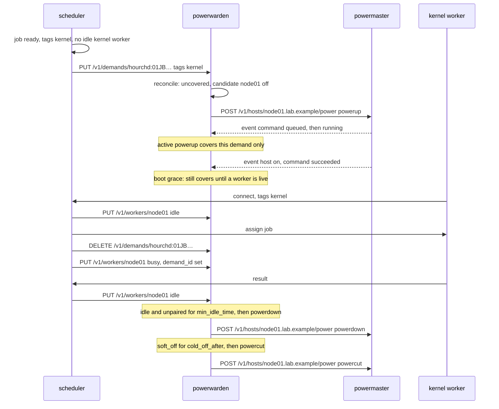

# powerwarden: Demand-Driven Host Power Policy

| | |
|---|---|
| Status | Implemented |
| Code | `powerwarden/daemon` (daemon, web UI), `powerwarden/api` (generated client), `powerwarden/mcp` (`pwrwrdn` CLI and MCP server) |
| Spec | `specs/openapi/powerwarden.yml` (OpenAPI 3.0.3) |
| Related | [`DESIGN-powermaster.md`](DESIGN-powermaster.md) (power control) |

## Overview

**powerwarden** decides which hosts in a small bare-metal fleet should be on. It serves one HTTP API for three
kinds of record:

- **demand**: work waiting for a machine with certain tags;
- **worker liveness**: which workers are up, on which host, and whether they are busy;
- **claims**: leases that people, scripts and AI agents hold on a host to keep it on, keep jobs off it, or take it
  over.

It reconciles those against host power state read from powermaster
([`DESIGN-powermaster.md`](DESIGN-powermaster.md)) and against host capability tags it stores itself, and asks
powermaster to power hosts up, down or off at the PDU. It holds no hardware credentials, never writes job-system
state, and serves a web UI for operators.

The demand and liveness publisher is a job scheduler. The reference publisher is hourchd, which knows which jobs are
ready and which workers are connected; workers talk only to the scheduler and never to powerwarden. Agents use the
claim API through `pwrwrdn` (`powerwarden/mcp`).

## Goals and non-goals

### Goals

- One REST API is the only demand, liveness and claim contract. Writers: the scheduler, operators and claim holders.
- Power actions go through powermaster's API. Host state and `locked` are read from powermaster; host tags are
  powerwarden's own. Powerwarden holds no BMC, PDU or SSH credentials.
- A demand not covered by a worker or an in-flight powerup powers on **one** host whose tags are a superset of the
  demand's tags. One worker covers one demand.
- "In flight" means powermaster has an active `powerup` or `reboot` command for the host, followed by a configurable
  boot grace. Never inferred from state names.
- A failed boot (powermaster `power_failed_at`) stops covering demand at once and starts a cooldown, so the next
  host can be chosen.
- A host powers off after a configurable idle dwell, and its PDU outlets are cut after a second, longer dwell.
  Locked and excluded hosts are never auto-managed.
- Workers take work as soon as they are up. Powerwarden does not gate job claims.
- Responsive: reconcile runs on every demand, worker, claim or powermaster event, with a timer backstop. A new
  demand with an off candidate produces a powerup request in **under 1s**, subject to the power-on spacing.
- Every time, interval and limit is in `config.yaml`.
- A web UI for operators.

### Non-goals

- Power sequencing, hardware polling, host state, `locked`: all powermaster.
- Job state, retries, timeouts: the scheduler.
- Requesting `reboot` on its own policy. Its own policy sends only `powerup`, `powerdown` and `powercut`. It sends
  `reboot`, and the other claim actions, only when a claim holder asks (`POST /v1/claims/{id}/power`).
- High availability. One daemon per fleet.

## Key decisions

1. **Powerwarden serves demand and liveness; the scheduler is its client.** The scheduler knows which jobs are
   ready and which workers are connected. Workers never call powerwarden and hold no powerwarden token.
2. **Demand, liveness and capability are three records.** Demand is a resource created because a job is ready and
   unassigned. Liveness is a worker record with a lease. Capability is `tags` on the host, stored in powerwarden's
   database (`host_policy.tags_json`), seeded from `host_tags` in `config.yaml`, and edited through the API and UI.
   An off machine has no live worker, so capability cannot come from liveness.
3. **One worker covers one demand.** Two queued `kernel` jobs and no idle kernel worker power two hosts, one per
   spacing interval. Parallelism is capped by the number of hosts whose tags cover the demand.
4. **No admission control.** Powerwarden influences work only by whether a machine is on. With claims it still does
   not gate job assignment: it publishes `jobs_blocked` on each host view for the scheduler to honour.
5. **In flight comes from powermaster commands, then boot grace.** A host with a `queued` or `running` `powerup`
   covers one demand. When the command fails, coverage ends and cooldown starts. When it succeeds, the host keeps
   covering one demand for `boot_grace` (default 5m) or until a live worker appears on it. This stops a slow-booting
   host from causing a second, needless powerup.
6. **Leases are fields on the resources.** `PUT` carries `lease_seconds`; the server sets `lease_until` from its own
   clock.
7. **Event-driven reconcile with a rate limit.** A pass runs after any write, any powermaster event, and every
   `reconcile_interval` (15s). At most one new powerup per `power_on_spacing` (15s) and one power-off per pass, so
   scale-out is stepwise and the PDUs never see a stampede.
8. **Cooldown and exclude are powerwarden policy.** Cooldown is `power_failed_at + boot_cooldown`. Exclude is a flag
   in powerwarden's store.
9. **Workers attach to hosts by exact hostname.** A liveness record's `hostname` must equal powermaster's
   `hostname`.
10. **Web UI served by powerwarden.** Go `html/template` pages plus a small script using `EventSource`, embedded
    with `go:embed`. No JS build step.
11. **Generated client, hand-written server.** `oapi-codegen` generates `powerwarden/api` from the spec;
    the scheduler and `pwrwrdn` import it.
12. **Named bearer tokens with roles.** One token for the scheduler, one per operator, one per user machine. None on
    a worker host. Names match `^[A-Za-z0-9_.@-]{1,64}$`; a user token is `<user>@<machine>`. A `tokens.yaml` entry
    is a string (role `full`) or `{token, role: full|agent}`. `full` may call everything. `agent` may `GET`
    everything and `PUT`/`POST`/`DELETE` under `/v1/claims*`; it gets 403 `forbidden` on demand, worker, host-tags
    and host-exclude writes, and cannot release another owner's claim. A role comes only from the entry, never from
    the name. One route-to-role table (`internal/httpapi/tokens.go`, `routeRoles`) is enforced in middleware.
13. **Two-stage power-off.** Idle hosts go `on` to `soft_off` (powerdown, rule 10), then `soft_off` to `cold_off`
    (powercut, rule 11) after `cold_off_after` (default 1h; 0 disables), so the PDU outlets are cut. A `soft_off`
    host is preferred for powerup (its BMC is already up). Powerwarden never powercuts a host a claim is bound to or
    a demand could use.

## Design

### Scale and timing

Defaults; all in `config.yaml`.

- Design capacity: **16 hosts**, **64 workers**, **500 open demands** (`limits.max_demands`), **64 live claims**
  (`limits.max_claims`).
- API load: scheduler PUT/DELETE on job transitions plus a 15s refresh; liveness on worker transitions plus a 15s
  refresh. Under 10 requests/s; one SQLite write per request; **p99 under 50ms**.
- Decision latency: new uncovered demand with an off candidate → powermaster `POST` in **under 1s**, or within
  `power_on_spacing` of the previous powerup.
- `demand_lease_default` **3600s** (covers two failed 15m boots if the scheduler is down). `worker_lease_default`
  **90s**.
- `busy_grace` **7200s**: a host whose last liveness was `busy` or `maintenance` stays up that long without a fresh
  `idle`.
- `min_idle_time` **10m**. `boot_grace` **5m**. `boot_cooldown` **10m**. `power_on_spacing` **15s**.
  `reconcile_interval` **15s**. `host_view_refresh` **60s**. `cold_off_after` **1h**.

### Components

```
 scheduler ── PUT/DELETE /v1/demands, PUT /v1/workers ──┐
 pwrwrdn / agents ── /v1/claims ────────────────────────┤
 browser ── web UI (/ui), basic auth ───────────────────┤
                                                        ▼
                         ┌──────────── powerwarden ────────────┐
                         │ HTTP API /v1 + web UI /ui           │
                         │ SQLite (demands, workers, claims,   │
                         │         host policy, settings)      │
                         │ reconciler (events + timer)         │
                         └───────┬───────────────▲─────────────┘
          powerup/powerdown/powercut               │ /v1/events, GET /v1/hosts
                                  ▼               │
                              powermaster ────────┘
```

| Package (under `powerwarden/daemon`) | Role |
|---|---|
| `internal/config` | `config.yaml`; unknown keys are an error |
| `internal/store` | SQLite: `demands`, `workers`, `host_policy`, `settings`, `claims`; claim binding (`bind.go`) |
| `internal/reconcile` | `Covers`, name tags, the pure `Plan` (eleven ordered rules), claim host snapshot, executor, event loop plus timer |
| `internal/pm` | powermaster `Client` interface, HTTP client over the generated `powermasterapi`, test fake |
| `internal/hostview` | Cached powermaster host view, folding in events |
| `internal/source` | Loads demand and liveness rows for each pass |
| `internal/decisions` | In-memory ring served by `/v1/decisions` |
| `internal/events` | SSE hub for `/v1/events` and `/ui/events` |
| `internal/app` | Operations shared by the API and the UI |
| `internal/httpapi` | `/v1` handlers (generated types), named bearer tokens and roles |
| `internal/ui` | `/ui`: templates, `EventSource` script, htpasswd basic auth |

### Who calls whom

| Caller | When | Call |
|---|---|---|
| Scheduler | A job becomes ready and no connected idle worker covers it | `PUT /v1/demands/{id}` |
| Scheduler | The job is assigned, cancelled or finished | `DELETE /v1/demands/{id}` |
| Scheduler | Every 15s | Re-`PUT` every open demand; `DELETE` rows of its own source it no longer has |
| Scheduler | Worker connects, disconnects, goes idle/busy; every 15s per worker | `PUT /v1/workers/{worker_id}`; `DELETE` on clean disconnect |
| Reconciler | Each pass | Reads its store and its cached powermaster view; calls powermaster `POST /v1/hosts/{h}/power` |
| Reconciler | Always | Subscribes to powermaster `/v1/events`; re-reads `GET /v1/hosts` on start, on `resync`, and every `host_view_refresh` |
| Agent (user token) | Claim, renew, release a host; power the claim's host | `/v1/claims*`; for power, powerwarden calls powermaster with its own token and `reason: "claim <id> by <owner>"`. The agent never holds a powermaster token |
| Web UI | Page load, then `/ui/events` | Reads list routes; exclude toggle, tags editor, manual demands, detached claims |

A failed call from the scheduler should be logged and retried on its next refresh; it must never fail a job
transition.

### Demand lifecycle

The example uses an example host `node01.lab.example` and a worker tagged `kernel`.



Demand ids: `hourchd:<job id>` from hourchd, free-form for `manual`. `source` is `hourchd` or `manual`. hourchd
deletes only `source=hourchd` rows. A manual demand holds a tag class up without a job.

### Reconcile rules

The pure match, used for liveness and host tags:

```go
// Covers reports whether have is a superset of need.
// An empty need is covered by every have.
func Covers(have, need []string) bool {
    set := make(map[string]struct{}, len(have))
    for _, t := range have {
        set[t] = struct{}{}
    }
    for _, t := range need {
        if _, ok := set[t]; !ok {
            return false
        }
    }
    return true
}
```

One pass, in order (eleven rules). Pairing is one-to-one: a worker or host never covers a second demand in the same
pass.

1. **Load.** Hosts from the cached powermaster view (`hostname`, `locked`, `state`, `state_since`, `active_command`,
   `power_failed_at`). Tags, exclude and `idle_since` from `host_policy`. Demands with `lease_until > now`. All
   worker rows, including expired ones: an expired row is the busy-hold record (`last_busy_at`), not a fresh worker.
   Live claims, then claim binding (see [Claims](#claims)) against this snapshot. Sweep demands older than
   `demand_sweep_after` (24h), worker rows older than `busy_grace + worker_sweep_extra` (24h), and claims lapsed or
   failed more than `claim_sweep_after` (24h) ago. Record `settings.last_alive_at`.
2. **Busy and maintenance cover only their claimed demand.** A fresh worker with `job_status` `busy` or
   `maintenance`, a known hostname, and `demand_id` equal to an open demand covers that demand if
   `Covers(worker.tags, demand.tags)`. Nothing else. Empty `demand_id` covers nothing. `error` covers nothing.
3. **Idle workers cover one demand each.** Fresh `idle` workers on a host whose state is `on`, sorted by
   `worker_id`. Open demands sorted by `created_at`, then id. Each idle worker takes the oldest remaining demand it
   covers.
4. **In-flight powerups cover one demand each.** A host whose `active_command` is a `powerup` in `queued` or
   `running` takes the oldest remaining demand that `Covers(host.tags, demand.tags)`. A job-blocked host (a bound
   `reserve` or `dedicated` claim) covers no demand here or in rule 5.
5. **Boot grace covers one demand.** A host whose last powerup `succeeded` less than `boot_grace` ago, with state
   `on` and no fresh worker, takes the oldest remaining demand it covers. A fresh worker on the host ends the grace.
6. **Power on for the oldest uncovered demand or claim.** If `now - last_powerup_request >= power_on_spacing`, take
   the oldest uncovered demand that has a candidate, or the oldest `hold`/`reserve` claim bound to an off host,
   whichever was created first, and request one powerup with `reason` set to the demand id or `claim:<claim id>`.
7. **Candidate.** Ordered `soft_off` first, then `cold_off`, then inventory order. State is an off state, not
   `locked`, not excluded, no active command, `power_failed_at` null or older than `boot_cooldown`, non-empty
   explicit tags, not job-blocked, and `Covers(host.tags, demand.tags)`. A claim's candidate is only its bound host,
   with the same checks except tags and job-blocking. A powermaster 409 or 5xx is logged, the host is skipped this
   pass, and the next pass retries. After a failed boot the local view sets `unknown`, which is neither a candidate
   nor idle-eligible, until powermaster's host event arrives.
8. **Busy hold.** Power-off is considered only when rule 6 made no request. A host is busy-held while any worker row
   on it has `last_busy_at` set and `now < last_busy_at + busy_grace`, even if the row's lease has expired. A newer
   `idle` clears `last_busy_at` and the hold at once.
9. **Idle-eligible.** State `on`, not locked, not excluded, no active command, not in boot grace, not busy-held, no
   live claim bound to the host (pending or ready), and no fresh worker on the host paired with an open demand. Host
   tags are not an input: a `kernel` host whose live worker reports `tiny` does not cover a kernel demand and is
   idle-eligible at once.
10. **Idle dwell.** `idle_since` is stored when the host becomes idle-eligible and cleared when it is not. A restart
    with no `idle_since` restarts the dwell (the safe direction). When `now - idle_since >= min_idle_time`, request
    one powerdown. One per pass.
11. **Cold-off.** Considered only when the pass made no powerup and no rule 10 powerdown: one power-off request per
    pass is shared by rules 10 and 11. A host gets a `powercut` when all hold: state `soft_off` with `state_since`
    known and `now - state_since >= timings.cold_off_after`; not locked, not excluded, no active command; no live
    claim bound to it; and not a candidate (rule 7) for any currently uncovered demand. `cold_off` hosts never get a
    powercut. Without `state_since` there is no cold-off. `cold_off_after: 0` disables it. The request reason is
    `soft_off <cold_off_after>` and the decision is `powercut_requested`. The host view's `cold_off_due_at` is
    `state_since + cold_off_after` while the host is a powercut candidate, else null.

Host power states come from powermaster and are read-only here: `unknown`, `soft_off` (chassis off, PDU outlets on,
BMC answering), `cold_off` (outlets cut), `powering_on`, `on`, `powering_off`, `rebooting`. `soft_off` and
`cold_off` are the off states (`pm.IsOff`).

Liveness tags and host tags may differ. Pairing uses liveness tags (that is what can take work). Host tags decide
whom to power on and what an in-flight or booting host may pair with. A mismatch logs an error. A liveness
`hostname` that matches no powermaster host is stored, shown in the UI, logged at error, and covers nothing.

### Host tags and name tags

`reconcile.MatchTags(index, host, explicit)` is the one matcher: explicit tags, minus stale ones, plus the host's
name tags. Demand cover and candidates (rules 4, 5, 7), claims and `GET /v1/hosts?tags=` all use it, with one
`NameIndex` built per host-list snapshot.

- Every host implicitly carries two name tags: its full hostname and its short name (before the first dot), for
  example `host01.example.com` and `host01`. Matching is exact and case-sensitive.
- API: `tags` is the explicit tags; read-only `name_tags` lists the name tags in effect.
- If two hosts share a short name (or a short name equals another host's full name), neither gets the short tag. It
  is omitted from `name_tags`, logged at error once per change, and flagged on the UI hosts page. It is not a
  startup error, because powermaster's inventory arrives after start.
- Name tags are reserved. `PUT /v1/hosts/{h}/tags` and the UI tags editor reject (400) an explicit tag equal to any
  known host's full or short name. `check-config` rejects a `host_tags` value equal to any `host_tags` key or its
  short form. At match time an explicit tag equal to a known host's name (for example a host added after the tag was
  set) is ignored, logged once per change, and flagged on the hosts page, so a stale tag can never steer a name-tag
  claim to the wrong host.
- Name tags are not capability. Rule 7 still requires non-empty explicit tags: a host with only name tags can be
  claimed but is never booted for a demand.

### Claims

A claim is a lease an agent (or an operator through the UI) holds on one host, chosen by tags. Agents use it to keep
a host on while they work on it, to stop scheduler jobs landing on it, or to take the host over. API:
`PUT/GET/DELETE /v1/claims/{id}`, `POST /v1/claims/{id}/extend`, `POST /v1/claims/{id}/power`, `GET /v1/claims`.
Code: binding in `internal/store/bind.go`, the host snapshot in `reconcile.BindHosts`, the power rules in
`internal/reconcile/plan.go`.

**Modes.** Fixed for the claim's life.

| mode | other claims on the host | scheduler jobs | power |
|---|---|---|---|
| `hold` (default) | hold/reserve allowed | allowed | powerwarden keeps it on, boots it if it goes off |
| `reserve` | hold/reserve allowed | blocked (`jobs_blocked`), drains first | same as hold |
| `dedicated` | none, exclusive | blocked (`jobs_blocked`), drains first | the claimant controls it; powerwarden takes no power action |

`jobs_blocked` on a host view is true while a live `reserve` or `dedicated` claim is bound to the host, draining
included.

**Selection by tags.** A claim always selects by tags, matched with `MatchTags` (explicit plus name tags); there is
no `hostname` field. To name a host, use its full or short name tag, alone or with other tags. A name tag plus an
explicit tag the host lacks matches nothing: the claim is `failed`, detail `no_host`. A host with only name tags can
be claimed, and is booted for a `hold`/`reserve` claim, but never for a demand.

**Owner and session.** The owner is the bearer token's name, never taken from the body. `session` is kept from the
creating PUT; a renew from another session of the same owner is accepted. Another token name gets 403.

**Leases and caps.** On create, `lease_seconds` defaults to `claim_lease_default` (15m, clamped to 60s..1h) and
`max_seconds` to `claim_cap_default` (8h, clamped to 15m..72h). `expires_at` is the hard cap; only extend moves it.
A re-PUT renews the lease and must restate `tags`, `mode` and `detached` (a difference is 409 `conflict`).

**Detached claims.** `detached: true` means no liveness lease (`lease_until` null). The claim lives until
`expires_at` or a release. The UI create form and `pwrwrdn claim` make them; the MCP server and `pwrwrdn run` never
do. The restart grace does not apply.

**Lapse.** A claim lapses when `expires_at <= now`, or `lease_until <= now` for a non-detached claim. A lapsed claim
binds nothing, holds nothing and is hidden unless `include_expired`; it is swept `claim_sweep_after` (24h) after it
lapsed. A re-PUT after lapse is 410 `claim_expired`.

**Binding.** Each pass re-evaluates every live claim that has not failed, oldest first, in one store transaction.
The PUT runs the same code in its own transaction, so two racing `dedicated` claims cannot both bind one host. The
host snapshot is the same for both: match tags, locked, excluded, power state, command in flight, boot cooldown,
fresh busy workers, inventory order.

- No host matches: `failed`, detail `no_host`. Every match locked or excluded: `failed`, detail naming each host and
  why. Failed is final: release and claim again.
- Free hosts: for `hold`/`reserve`, a match with no live `dedicated` claim; for `dedicated`, a match with no live
  claim of any mode and no command in flight.
- `hold`/`reserve` pick, in order:
  1. an `on` host with no command in flight, fewest live claims first, then inventory order;
  2. a host with a powerup or reboot in flight;
  3. an off host with no command and no boot cooldown, `soft_off` before `cold_off`, then inventory order.
- `dedicated` picks `on`, then `soft_off`, then `cold_off`, then inventory order. It never boots one. With none free
  it stays `pending`; it never gets a create-time 409.
- No free host: `pending`, unbound, detail `waiting for <hosts>`, or `cooldown` when every host the claim could
  share is in boot cooldown.
- **A bound claim never moves.** Its `hostname` never changes, in any mode. A caller who wants work that can land on
  any matching host uses a demand. A bound claim that can no longer be served fails instead.

**A failed claim.** A bound claim fails (state `failed`, `detail` the reason) when:

- its host is gone from the synced powermaster inventory, in every mode: `host <h> removed from inventory`;
- `hold`/`reserve`, and its host is not `on` and is
  - locked while off: `host <h> locked`;
  - excluded while off: `host <h> excluded`;
  - in boot cooldown (`power_failed_at` within `boot_cooldown`): `boot failed on <h>`. This covers a failed powerup
    for the claim (reason `claim:<id>`) and a failed reboot the claim holder asked for.

On an `on` host, lock, exclude or cooldown leaves the claim `ready`. An unbound claim keeps waiting. A claimed host
that goes off with none of those is booted again for a `hold`/`reserve` claim, and only a failed boot fails the
claim. A powermaster request error (no command created) does not fail it; the next pass retries. `dedicated` is
never failed by lock, exclude or cooldown. An unsynced inventory keeps every claim as it is.

A failed claim is final and holds nothing:

- It keeps `hostname` as a record of the host that failed it; `host_state` is null.
- It is not in the plan, not in the host view's `claims`, not `jobs_blocked`, not in binding occupancy or dedicated
  exclusivity, not in `host_shared`, and not counted toward `limits.max_claims`. The host's idle dwell runs and a new
  `dedicated` claim can bind it. Its `version` no longer follows host state changes.
- Renew (PUT), extend and power get **410 `claim_failed`** with the detail in `message`. `GET` still returns it;
  `DELETE` is 204. It is listed until swept.
- A waiting blocking read wakes at once: the version bumps when the state changes.
- It is swept `claim_sweep_after` (24h) after it failed (`updated_at`, which stays fixed), or when it lapses,
  whichever comes first.
- To get another host, release the claim and claim again. A tag-class claim made again skips the cooling host.

`pwrwrdn` (MCP keeper and `run`) treats 410 `claim_failed` on a renew as a lost claim, with the detail as the reason.

**Lifecycle and ready.** One function, `store.BoundState`, decides the state of a bound claim:

- `hold`/`reserve`: `ready` means the bound host is `on` and has no command in flight. Otherwise `pending`, with
  detail `waiting for powerup` (off), `booting` (powerup or reboot in flight), `command in flight`, or
  `host <state>`.
- A `ready` `hold`/`reserve` claim whose host goes off (operator powerdown, crash) returns to `pending`, and
  powerwarden powers the host back up for it. A powerup or reboot on the host makes it `pending` until the host is
  `on` again.
- `dedicated`: `ready` once bound and drained, whatever the power state. `host_state` tells the caller.
- `version` is bumped when `state`, `detail` or `hostname` changes, so each step is visible. `GET /v1/claims/{id}`
  with `since=<version>&wait=<seconds>` blocks until the version changes (at most `claim_wait_max`, 60s). Lease
  renewals and extends do not change `version`.

**Draining** (`reserve`, `dedicated`). Uses only worker liveness:

- While any fresh worker row on the bound host has `job_status` `busy` or `maintenance`, the claim is `pending`,
  detail `draining`. Once none is, it goes `ready`.
- A `reserve` host is booted and held on while draining, as `hold` would be.
- A worker that goes busy after the claim is `ready` does not move it back.
- There is no drain timeout of its own: draining is bounded only by the claim's lease and hard cap.

**Reconcile rules for claims.**

- A `hold`/`reserve` claim bound to an off host asks for that host's powerup in rule 6, and that host only. It
  shares the queue (oldest first, demands and claims together) and `power_on_spacing`, `boot_grace` and
  `boot_cooldown` with demands. The reason is `claim:<id>`. A failed boot puts the host in cooldown and fails the
  claim.
- A host with a live claim bound (pending or ready, any mode) is never idle-eligible (rule 9) and never power-cut
  (rule 11).
- A job-blocked host (`reserve` or `dedicated`) is never a rule 7 candidate for a scheduler demand and covers no
  demand by booting (rules 4, 5). A `reserve` host is still booted for its own claim.
- `dedicated`: while the claim lives, powerwarden sends no powerup, powerdown or powercut for the host and never
  picks it as a boot candidate for a demand or another claim. Rules 6, 7, 9, 10 and 11 skip it.
- Workers and demands are otherwise unaffected: rules 2 and 3 still pair fresh workers on a claimed host.
- On release or lapse the host returns to normal policy: idle dwell from that pass, then powerdown, then cold-off.
  An off host stays off.

**Restart grace.** Each pass records `settings.last_alive_at`. At start, before the first pass, a non-detached claim
whose `lease_until` falls after `last_alive_at` and at or before now (it lapsed while powerwarden was down) gets
`lease_until = now + claim_restart_grace` (5m), capped at `expires_at`. This gives the agent time to renew.

**`jobs_blocked` is advisory.** Powerwarden publishes it; it is up to the scheduler to stop assigning jobs to
workers on a blocked host. Until the scheduler does:

- For `hold`/`reserve`, the `worker_busy` refusal on the claim power call protects a running job: the claimant
  cannot reboot the host under it.
- For `dedicated`, nothing protects a job assigned after the claim is `ready`: a busy worker never blocks the
  claimant's power actions. Grant-time draining is the only protection. A dedicated power command sent while a
  worker on the host is busy is logged at warn (claim, owner, action, worker ids, demand ids) and recorded as
  decision `claim_power_over_busy_worker`, so a killed job can be explained afterwards.

**Claim power call.** `POST /v1/claims/{id}/power {action}`, owner only (a `full` token that is not the owner is
refused too). Allowed: `hold`/`reserve`: `powerup`, `reboot`; `dedicated`: all four. Refusals, in order: 403
`forbidden`, 410 `claim_expired`, 410 `claim_failed`, 409 `claim_not_ready` (not bound, or `draining`), 409
`action_not_allowed`, then for `hold`/`reserve` only 409 `host_shared` (another owner has a live claim on the host)
and 409 `worker_busy`, then powermaster's own 409 `host_locked` (no force on this path) and `command_in_flight`, and
502 `powermaster_unreachable`. The reply is powermaster's command object: 202 when queued, 200 when the host is
already there. Every request that reaches powermaster is recorded as decision `claim_power_requested`.

### What a crash does

| Crash | Effect |
|---|---|
| Scheduler down | No demand or liveness updates. Demand leases run up to `demand_lease_default`. Busy-held hosts stay up for `busy_grace` plus dwell. Jobs resume when the scheduler returns |
| powerwarden down | No power decisions. Hosts stay as they are. The scheduler retries on its next refresh. Workers keep working |
| powerwarden restart | Store survives. Expired worker rows still busy-hold. The powermaster view is rebuilt from `GET /v1/hosts` before the first pass |
| powermaster down | No requests. The last-known host view is kept; nothing is powered off while the view is older than `host_view_refresh` |
| Worker dies mid-job | The scheduler requeues the job; liveness goes stale; the host is busy-held until `busy_grace` or a newer idle. The requeued job is a new demand |
| Claim holder dies | Its lease runs out; the claim lapses and the host follows the idle dwell, then powerdown. A detached claim lives on until `expires_at` or a release |
| powerwarden restart with claims | Claims are in the store. A claim whose lease ran out while powerwarden was down gets `claim_restart_grace`; detached claims are untouched. Binding re-runs on the first pass |
| Claimed host crashes or is powered off | `hold`/`reserve`: the claim returns to `pending` and powerwarden boots the host again; a failed boot fails the claim. `dedicated`: the claim stays `ready`; `host_state` shows the change and powerwarden does nothing |

### Web UI

Served at `/ui` (the site root redirects there). Pages are `html/template`, live updates come from `EventSource` on
`/ui/events` (the same hub as `/v1/events`, behind basic auth, because `EventSource` cannot send a bearer header),
and assets are embedded with `go:embed`. Basic auth comes from an htpasswd file (`ui.htpasswd_file`, bcrypt entries
only). UI POSTs must carry an `Origin` (or `Referer`) whose host equals the request `Host`; that is the CSRF guard,
so a reverse proxy in front must preserve `Host`.

Behind a reverse proxy that gives each service a path prefix and neither strips nor rewrites it, set `ui.path_prefix`
(for example `/powerwarden`): the UI is then served under `<prefix>/ui/...`, every link, form action, redirect and the
`EventSource` URL carries the prefix (templates use `{{base}}`; `app.js` reads `<body data-base>`), and the site root,
`<prefix>` and `<prefix>/` redirect to `<prefix>/ui/hosts`. With the default empty prefix every URL is `/ui/...`.

- **Hosts.** Power state (read-only, from powermaster), tags, name tags, locked, excluded, policy status (busy-held
  until, idle dwell, booting, boot grace, cooldown, cold off in mm:ss), paired demand, workers, claims. Exclude
  toggle and tags editor.
- **Demands.** Open demands oldest first: id, tags, source, age, lease remaining, `covered_by`. Uncovered demands
  with no candidate are highlighted. Create and delete manual demands.
- **Workers.** id, hostname, tags, `job_status`, `demand_id`, lease remaining, busy-hold remaining. Unknown
  hostnames and tag mismatches flagged.
- **Claims.** Live claims; create a detached claim; release one.
- **Decisions.** Live feed of `/v1/decisions`: why each host was powered up or down, or why nothing happened.
- **Header.** powermaster connection state, demand counts, fresh workers, last pass, last power request.

No power buttons. Manual power is `powermaster monitor`, or a claim's power call.

## Configuration

`/etc/powerwarden/config.yaml`, path overridable with `--config`.
[`powerwarden/daemon/config.yaml.example`](../powerwarden/daemon/config.yaml.example) holds every
key with its default. Unknown keys are a startup error. Durations use Go syntax.

| Key | Default | Meaning |
|---|---|---|
| `listen` | `:8091` | HTTP listen address (plain HTTP) |
| `state_path` | `/var/lib/powerwarden/state.db` | SQLite file |
| `tokens_file` | `/etc/powerwarden/tokens.yaml` | `name: token` or `name: {token, role: full\|agent}`; tokens at least 16 characters; keep it mode 0600 |
| `log_level` | `info` | `debug`, `info`, `warn`, `error` |
| `powermaster.url` | **none: required** | Base URL of powermaster |
| `powermaster.token_file` | `/etc/powerwarden/powermaster.token` | powerwarden's own powermaster token |
| `powermaster.request_timeout` | `10s` | Per request |
| `timings.reconcile_interval`, `power_on_spacing`, `host_view_refresh` | `15s`, `15s`, `60s` | Reconcile pacing |
| `timings.boot_grace`, `boot_cooldown`, `min_idle_time`, `busy_grace` | `5m`, `10m`, `10m`, `7200s` | Power policy |
| `timings.cold_off_after` | `1h` | `soft_off` dwell before a powercut; `0` disables |
| `timings.demand_lease_default`, `_min`, `_max` | `3600s`, `30s`, `3600s` | Demand leases |
| `timings.worker_lease_default`, `_min`, `_max` | `90s`, `15s`, `300s` | Worker leases |
| `timings.demand_sweep_after`, `worker_sweep_extra` | `24h`, `24h` | Sweeps |
| `timings.claim_lease_default`, `_min`, `_max` | `15m`, `60s`, `1h` | Claim leases |
| `timings.claim_cap_default`, `_min`, `_max` | `8h`, `15m`, `72h` | Claim hard caps |
| `timings.claim_restart_grace`, `claim_wait_max`, `claim_sweep_after` | `5m`, `60s`, `24h` | Claims |
| `limits.max_demands`, `max_claims`, `max_tags`, `decisions_kept` | `500`, `64`, `32`, `500` | Capacity |
| `events.ring_size`, `events.heartbeat` | `1000`, `15s` | SSE resume ring and heartbeat |
| `ui.enabled`, `ui.htpasswd_file` | `true`, `/etc/powerwarden/ui.htpasswd` | Web UI |
| `ui.path_prefix` | `""` | Serve the UI under `<prefix>/ui` (for a reverse proxy that keeps the prefix). Empty, or `/segment[/segment...]` with no trailing `/` and segments of letters, digits, `. _ ~ -`; no `..` |
| `host_tags` | none | Optional seed: `hostname: [tags]`, applied only to hosts with no stored tags |

`powerwarden check-config [--config PATH] [--tokens-file PATH]` loads the config, then the tokens file with the
loader `serve` uses; `--tokens-file` overrides `tokens_file` so a rendered pair can be checked off-box. A missing or
invalid tokens file exits 1. Success prints `ok: listen=… powermaster=… tokens=N (full=a, agent=b)`; token values
are never printed.

Secrets are never in `config.yaml`: the tokens, the powermaster token and the htpasswd are separate files.

## API

The contract is `specs/openapi/powerwarden.yml`. Bodies are `application/json`. Unknown fields are rejected with
400. All `/v1` routes except `GET /v1/healthz` require `Authorization: Bearer <token>`. The error body is
`{"error": "<code>", "message": "..."}`; codes are `unauthorized`, `bad_request`, `forbidden`, `not_found`,
`conflict`, `capacity`, `claim_expired`, `claim_failed`, `claim_not_ready`, `action_not_allowed`, `host_shared`,
`worker_busy`, `host_locked`, `command_in_flight`, `powermaster_unreachable`.

### Demands

`PUT /v1/demands/{id}`: id pattern `^[A-Za-z0-9_.:-]{1,160}$`. If the body has `id`, it must equal the path. **200**
with the stored object. Idempotent.

```json
{
  "id": "hourchd:01JBF6Q9W2X7…",
  "tags": ["kernel"],
  "lease_seconds": 3600,
  "source": "hourchd",
  "external_ref": "run 01JBF6P… job build:hello"
}
```

- `tags`: up to `limits.max_tags` strings, each `^[A-Za-z0-9_.-]{1,64}$`. Zero tags means any worker.
- `lease_seconds`: between the configured min and max. Omitted on create means the default; omitted on refresh
  keeps the stored value.
- `source`: `hourchd` or `manual`.
- `external_ref`: optional label, at most 512 characters, never dereferenced.

The response adds `lease_until`, `created_at` (kept across refreshes) and `updated_at`. Errors: **400**, **401**,
**429** `capacity` at `limits.max_demands` for a new id.

`DELETE /v1/demands/{id}`: **204** whether or not the row existed. `GET /v1/demands` and `GET /v1/demands/{id}`:
unexpired rows (`?include_expired=true` for swept-pending rows), each with `covered_by` (`worker:<id>`,
`host:<hostname>`, or null) from the last pass.

### Workers

`PUT /v1/workers/{worker_id}`: pattern `^[A-Za-z0-9_.-]{1,128}$`. **200**, idempotent.

```json
{
  "worker_id": "node01",
  "hostname": "node01.lab.example",
  "tags": ["kernel"],
  "job_status": "busy",
  "demand_id": "hourchd:01JBF6Q9W2X7…",
  "lease_seconds": 90
}
```

`job_status`: `idle`, `busy`, `error`, `maintenance`. `demand_id` is required for a busy worker to cover that
demand. The response adds `lease_until`, `last_busy_at`, `updated_at`. `DELETE` is **204** always. `GET /v1/workers`
hides `lease_until <= now` unless `?include_expired=true`; hidden rows still busy-hold until swept.

### Claims

`PUT /v1/claims/{id}` (create or renew), `GET /v1/claims/{id}` (optionally blocking, `since` and `wait`),
`DELETE /v1/claims/{id}` (release, 204), `POST /v1/claims/{id}/extend` (set the hard cap to now plus a duration,
clamped), `POST /v1/claims/{id}/power`, and `GET /v1/claims?owner=&mine=&hostname=&include_expired=`. The PUT body
is `tags` (at least one), `purpose`, optional `session`, `mode`, `max_seconds`, `lease_seconds` and `detached`. A
claim object carries `id`, `owner`, `session`, `purpose`, `mode`, `detached`, `tags`, `hostname`, `host_state`,
`state` (`pending`, `ready`, `failed`), `detail`, `version`, `lease_seconds`, `lease_until`, `expires_at`,
`created_at`, `updated_at`. Semantics are under [Claims](#claims).

### Hosts

`GET /v1/hosts` (optional `?tags=`) and `GET /v1/hosts/{hostname}`: the policy view joined with the powermaster
view: `hostname`, `tags`, `name_tags`, `state`, `state_since`, `locked`, `exclude`, `idle_since`, `cold_off_due_at`,
`cooldown_until`, `boot_grace_until`, `busy_held_until`, `paired_demand`, `workers`, `claims`, `jobs_blocked`. No
hardware fields.

`PUT /v1/hosts/{hostname}/exclude` with `{"exclude": true}`: **200** with the host view; **404** if powermaster does
not know the host.

`PUT /v1/hosts/{hostname}/tags` with `{"tags": ["kernel"]}`: replaces the stored tags (sorted, de-duplicated, same
pattern and limit as demand tags; name tags rejected). **200** with the host view; **404** if powermaster does not
know the host. An empty list stores "no capability": the host is never powered on for demand. `host_tags` in
`config.yaml` seeds only hosts with no stored value, at start.

### Decisions, events, health, stats

- `GET /v1/decisions`: the last `limits.decisions_kept` reconcile actions and skips, newest first: `ts`, `action`
  (`powerup_requested`, `powerdown_requested`, `powercut_requested`, `request_failed`, `no_candidate`,
  `boot_grace_expired`, `cooldown_started`, `claim_power_requested`, `claim_power_over_busy_worker`), `hostname`,
  `demand_id`, `command_id`, `detail`. In memory.
- `GET /v1/events`: server-sent events `demand`, `worker`, `claim`, `host` (policy view), `decision` and `resync`,
  each with a `seq`. Resume as in powermaster (`Last-Event-ID`, ring, `resync`).
- `GET /v1/healthz`: no auth; 200 when serving with SQLite open, else 503; includes
  `powermaster: connected | unreachable`. No inventory.
- `GET /v1/stats`: `last_reconcile_at`, `demands_open`, `demands_covered`, `demands_uncovered`, `workers_fresh`,
  `hosts_by_policy`, `last_power_request`.

### Client module

`powerwarden/api` is generated from the spec with `oapi-codegen` v2, committed, with a `just drift` check and
a spec-coverage test, as for powermaster.

## Data model

`state_path` (default `/var/lib/powerwarden/state.db`, on local disk). `modernc.org/sqlite`, one `*sql.DB`,
`SetMaxOpenConns(1)`, WAL, `busy_timeout=5000`, migrations at open.

```sql
CREATE TABLE demands (
  id            TEXT PRIMARY KEY,
  tags_json     TEXT NOT NULL,
  lease_seconds INTEGER NOT NULL,
  lease_until   TEXT NOT NULL,
  source        TEXT NOT NULL,
  external_ref  TEXT NOT NULL DEFAULT '',
  created_at    TEXT NOT NULL,
  updated_at    TEXT NOT NULL
);

CREATE TABLE workers (
  worker_id     TEXT PRIMARY KEY,
  hostname      TEXT NOT NULL,
  tags_json     TEXT NOT NULL,
  job_status    TEXT NOT NULL,
  demand_id     TEXT NOT NULL DEFAULT '',
  lease_seconds INTEGER NOT NULL,
  lease_until   TEXT NOT NULL,
  last_busy_at  TEXT,                     -- set on busy/maintenance, cleared on idle
  updated_at    TEXT NOT NULL
);

CREATE TABLE host_policy (
  hostname           TEXT PRIMARY KEY,
  exclude            INTEGER NOT NULL DEFAULT 0,
  tags_json          TEXT,                -- capability tags; NULL = never set (seeded from host_tags)
  idle_since         TEXT,
  last_powerup_ok_at TEXT,                -- from powermaster command events; drives boot grace
  last_request_id    INTEGER,
  last_request_at    TEXT
);

CREATE TABLE settings (
  key   TEXT PRIMARY KEY,
  value TEXT NOT NULL                     -- e.g. last_powerup_request, last_alive_at (restart grace)
);

CREATE TABLE claims (
  id            TEXT PRIMARY KEY,
  owner         TEXT NOT NULL,            -- token name
  session       TEXT NOT NULL DEFAULT '',
  purpose       TEXT NOT NULL,
  mode          TEXT NOT NULL,            -- hold | reserve | dedicated
  detached      INTEGER NOT NULL DEFAULT 0,
  tags_json     TEXT NOT NULL,
  hostname      TEXT,                     -- bound host; never changes once set
  state         TEXT NOT NULL,            -- pending | ready | failed
  detail        TEXT NOT NULL DEFAULT '',
  version       INTEGER NOT NULL,
  lease_seconds INTEGER,
  lease_until   TEXT,                     -- NULL for detached claims
  expires_at    TEXT NOT NULL,            -- hard cap
  created_at    TEXT NOT NULL,
  updated_at    TEXT NOT NULL
);
CREATE INDEX claims_hostname ON claims (hostname);
```

The file is powerwarden's private state. If it is deleted: demands and workers reappear on the scheduler's next
refresh; exclude flags, stored host tags (re-seeded from `host_tags`) and claims are lost; busy-hold is lost until the
next busy liveness.

## Deployment

Powerwarden is one container (or one binary) with one SQLite volume. Run it under any orchestrator: compose,
systemd, Nomad or Kubernetes all work, as long as there is exactly one instance per fleet.

### Image

`powerwarden/daemon/cmd/powerwarden/Dockerfile` builds a static binary on `golang:1.25-bookworm` and runs it
on `debian:bookworm-slim` with only `ca-certificates`: powerwarden touches no hardware. The image copies
`config.yaml.example` to `/etc/powerwarden/`, declares the volume `/var/lib/powerwarden`, exposes 8091 and runs
`powerwarden serve --config /etc/powerwarden/config.yaml`. The build context is the repository root.

Build it with the leaf justfile (`just image [tag]`, `just push [tag]` in `powerwarden/daemon`). The recipes
read three settings from the environment, or from a gitignored `images.env` that `just` finds by searching upward
from the leaf (template: `images.env.example` at the repository root):

| Setting | Effect |
|---|---|
| `IMAGE_REGISTRY` | Registry prefix, e.g. `registry.example.com` (a trailing `/` is trimmed). Empty gives the local tag `powerwarden:<tag>`; `push` then refuses to run |
| `IMAGE_CA_CERT` | Absolute path to an extra CA certificate (PEM) to trust inside the image, e.g. the CA that signed powermaster's TLS certificate. Staged as `cmd/powerwarden/extra-ca/extra-ca.crt` for the build and removed afterwards. Empty: system CAs only |
| `LOGS_HOST` | Host for `just logs [host]`, which runs `docker compose logs -f` over SSH (the recipe expects the compose project in `$LOGS_DIR/powerwarden` on that host). No default |
| `LOGS_DIR` | Directory on `LOGS_HOST` that holds the compose projects. No default: `just logs` fails when it is unset |

### What the container needs

- `config.yaml` with `powermaster.url` set (the only required key), and optionally `host_tags`.
- `tokens.yaml` (0600): one `full` token for the scheduler, one per operator, `agent` tokens for user machines.
- `powermaster.token`: powerwarden's entry in powermaster's `tokens.yaml`.
- `ui.htpasswd` (bcrypt, `htpasswd -B`) when the UI is enabled.
- A persistent volume at `/var/lib/powerwarden` on local disk.
- Network reach to powermaster. No Vault access: powerwarden reads no inventory secrets.
- A TLS-terminating reverse proxy in front that preserves `Host`: the daemon serves plain HTTP.

### Compose example

Placeholder names; powerwarden and powermaster usually run side by side.

```yaml
services:
  powerwarden:
    image: registry.example.com/powerwarden:latest
    restart: unless-stopped
    ports: ["127.0.0.1:8091:8091"]           # put a TLS proxy in front
    volumes:
      - ./data:/var/lib/powerwarden
      - ./config.yaml:/etc/powerwarden/config.yaml:ro          # powermaster.url: http://powermaster:8092
      - ./tokens.yaml:/etc/powerwarden/tokens.yaml:ro
      - ./powermaster.token:/etc/powerwarden/powermaster.token:ro
      - ./ui.htpasswd:/etc/powerwarden/ui.htpasswd:ro
```

### Checks after a deploy

- `powerwarden check-config` passes; `GET /v1/healthz` is 200 with `powermaster: connected`.
- The UI lists hosts, and the scheduler's demands and workers once it runs.
- One queued job for a tag class powers one host; a second concurrent job powers a second host
  `power_on_spacing` later, and never a third.
- An induced boot failure moves to the next host.
- One idle powerdown follows `min_idle_time`, and a powercut follows `cold_off_after`.

## Security

- **Trust boundary.** The API belongs on a management network behind TLS. Callers: the scheduler, operators, claim
  holders and the UI. A `full` token can create demands (keeping hosts on) and fake liveness (pinning hosts on). An
  `agent` token cannot power a host directly, but with a claim it can: it can reboot any host it claims, and
  power-cycle or cut `dedicated` ones even with a job running (grant-time draining is the only guard). It can also
  mark every claimable host job-blocked by holding `reserve`/`dedicated` claims, up to the hard cap (72h).
- **No hardware secrets.** Powerwarden holds only its powermaster token.

| Threat | Severity | Mitigation |
|---|---|---|
| Stolen powerwarden token pins hosts on | Medium | Tokens kept in a secret store, written 0600 only on the powerwarden host and operator machines; `max_demands` and `max_claims` caps; agent role for user machines |
| Stolen powermaster token from powerwarden's container | High | No BMC credentials in powerwarden; powermaster still enforces `locked` |
| UI used without auth | Medium | htpasswd basic auth over TLS; same-origin check on POSTs; UI writes limited to exclude, tags, manual demands and claims |
| Demand id or tag used for injection | Low | Regexes on PUT; `external_ref` never fetched; templates auto-escape |

No CORS. Identical 401 bodies. `healthz` returns no inventory. `check-config` never prints a token value.

## Observability

- Reconcile summary at info on any change, at most once a minute otherwise.
- Power request and outcome at info; powermaster `failed` at error with `command_id`.
- Liveness hostname not in inventory: error. Liveness tags differ from host tags: error.
- No candidate for an uncovered demand: warn, once per demand per minute.
- `/v1/decisions` and the UI decisions feed answer "why did that host turn on".
- `GET /v1/stats` for dashboards. Logs go to stdout.

## Risks

| Risk | Severity | Mitigation |
|---|---|---|
| Boot grace too short; a slow worker start causes a second powerup | Medium | `boot_grace` in config; a decision is logged when grace expires with no worker |
| Event stream drops and powerwarden acts on stale host state | Medium | `resync`, periodic full re-read, no power-off on a stale view |
| Busy grace too short powers off a long job | High | 7200s default, configurable; kept on the worker row past lease expiry |
| Workers for a tag class run on a host outside powermaster's inventory | Low | Their demand is covered by those workers, so it never causes a powerup; keep always-on workers out of the managed tag classes or accept that |
| A pending `dedicated` claim has no queue position | Low | `hold`/`reserve` claims that arrive later can keep binding to its matches, so it can wait as long as they keep coming |
| `jobs_blocked` ignored by the scheduler | Medium | `worker_busy` refusal for `hold`/`reserve` power calls; warn and decision record for `dedicated` |

## Alternatives considered

### A. One daemon for demand and power

Rejected in [`DESIGN-powermaster.md`](DESIGN-powermaster.md): it puts every BMC credential in the policy process.

### B. Powerwarden polls the scheduler for ready jobs

Puts job statuses into powerwarden and adds a poll interval to every transition. Pushing a demand document keeps job
semantics in the scheduler.

### C. Demand as keys in a shared key-value store

A key-layout contract with TTL as the crash model, no auth and no status codes. Rejected for an explicit API with
leases.

### D. Admission control on the claim path

Having workers wait for a "you may claim" signal from powerwarden makes stopping powerwarden stop idle workers.
Rejected: powerwarden influences work only through power.

### E. Capability from worker records

Deriving "this off host can run `kernel`" from worker records left behind by whatever once ran there goes stale.
Rejected for explicit host tags.

## Open questions

None.
